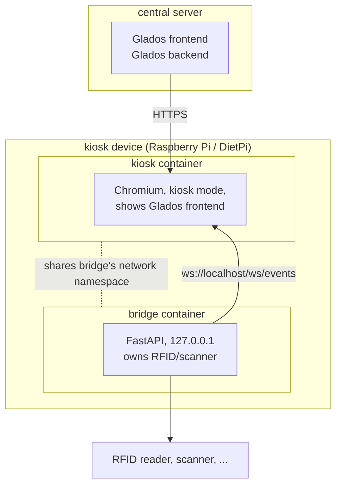

# glados-terminal

Shop-floor kiosk terminal for [Glados](https://github.com/deloarts/glados), the manufacturing / production-planning system. This repo is a Python 3.13 FastAPI **hardware bridge daemon**: it owns the local devices on a kiosk SBC (RFID reader, QR/barcode scanner, more later) and pushes their events to the Glados frontend page over a WebSocket. It also keeps this device's identity for the Glados backend: a generated Ed25519 key pair and the API key from `.env`. The page reads the public key and the API key at `GET /identity` and has the bridge sign its sign-in challenge at `POST /identity/sign`; the private key never leaves the bridge. It does **not** host or render the frontend, and it carries no business logic and makes no authentication decisions.



The bridge binds `127.0.0.1` only, enforced by the Docker Compose port mapping
(`docker-compose.yml`) — it must never be reachable over the network. The frontend on an HTTPS
origin can still talk to `ws://localhost:8600`, since Chromium exempts `localhost` from
mixed-content blocking.

## Quickstart

Local development (no hardware, no Docker):

```bash
poetry install
cp .env.dev.example .env.dev
ENV_FILE=.env.dev poetry run uvicorn src.main:app --reload --port 8600
```

`.env.dev.example` enables the mock device, so `POST /debug/simulate` can inject fake RFID/scanner
events for frontend development. See [docs/DEVELOPMENT.md](docs/DEVELOPMENT.md).

On the actual kiosk device (Raspberry Pi running DietPi), from a checkout of the release tag:

```bash
cp .env.example .env
nano .env
docker compose pull
docker compose up -d
```

The device pulls the `linux/arm64` images CI publishes with every release, it builds nothing
itself. See [docs/INSTALLATION.md](docs/INSTALLATION.md) for the full provisioning walkthrough.

## Docs

- [docs/DEVELOPMENT.md](docs/DEVELOPMENT.md) — local setup, running without hardware, test/lint gates.
- [docs/INSTALLATION.md](docs/INSTALLATION.md) — provisioning a DietPi kiosk device.
- [docs/BRIDGE_API.md](docs/BRIDGE_API.md): every bridge route and its JSON, the contract
  the Glados frontend codes against.
- [docs/RELEASING.md](docs/RELEASING.md) — versioning, the trunk-based release flow, CI and the
  published images.
- [CHANGELOG.md](CHANGELOG.md) — what changed in each release.

The WebSocket event envelope and the layering rules for adding a new device type are documented in
the `architecture` skill (`.claude/skills/architecture/SKILL.md`).

## License

glados-terminal is source-available under the [DELOARTS License (DAL) 1.0.0](LICENSE.md). You may use, change and share it for noncommercial purposes: personal use, research and study, and use by charitable, educational, public research and government organizations. Any commercial use, including running it on terminals inside a business, needs a separate commercial license from license@deloarts.com.

Third-party components bundled with glados-terminal remain under their own licenses.
