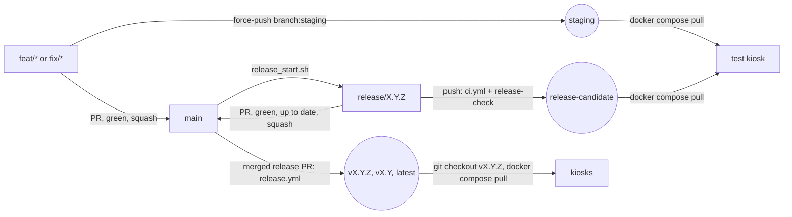

# releasing

- [releasing](#releasing)
  - [1 versioning policy](#1-versioning-policy)
  - [2 branches and release flow](#2-branches-and-release-flow)
    - [2.1 day-to-day work](#21-day-to-day-work)
    - [2.2 cutting a release](#22-cutting-a-release)
    - [2.3 what ci does at each step](#23-what-ci-does-at-each-step)
    - [2.4 when the release run fails](#24-when-the-release-run-fails)
  - [3 test channels: staging and release-candidate](#3-test-channels-staging-and-release-candidate)
    - [3.1 deploying to staging](#31-deploying-to-staging)
    - [3.2 pointing a test kiosk at a channel](#32-pointing-a-test-kiosk-at-a-channel)
  - [4 images](#4-images)
  - [5 github setup](#5-github-setup)

This document covers how glados-terminal is versioned and released. The flow is the one the main
Glados repository uses, without the parts that only exist there (two halves sharing a version,
OpenAPI snapshots, database migrations).

Development is trunk-based: `main` is the only long-lived branch, every change reaches it as a
squash-merged pull request, and `main` is always releasable. A release is a pull request from
`release/X.Y.Z` that only bumps the version and the CHANGELOG. Merging it is the release: a
workflow tags the merge commit and publishes the images, nobody pushes a tag by hand.

## 1 versioning policy

`[project].version` in `pyproject.toml` is the one source of truth. `src/const.py` reads it at
import time, so `GET /health` reports the version that is actually running. `docker-compose.yml`
mirrors it as the default image tag of both services (`${TERMINAL_VERSION:-vX.Y.Z}`), so a device
that checks out the tag `vX.Y.Z` pulls the `vX.Y.Z` images without any further setting. Set all
three at once with:

```bash
scripts/bump_version.sh X.Y.Z
```

CI's `version-parity` job fails the build if they disagree.

Versions are `0.Y.Z`, and the first release is `0.1.0`. `scripts/check_release_version.sh` only
accepts `0.Y.Z`; it is the only place that checks the major.

| Level | Meaning |
| --- | --- |
| **major** | Always `0`. |
| **minor** | The bridge protocol changed: the `/ws/events` envelope or an event's `data`, `GET /health`, `GET /devices`, `GET /identity`, `POST /identity/sign` (including the signed message prefix), `GET /display`, `POST /display`, `GET /device`. Additions count too. The shapes are in [BRIDGE_API.md](BRIDGE_API.md). |
| **patch** | No change to the bridge protocol. Bugfixes, new device drivers that reuse existing event types, image and dependency updates. |

glados-frontend is what consumes the protocol, so a minor is the signal to check it against the
frontend before rolling it out.

## 2 branches and release flow



### 2.1 day-to-day work

1. Branch from an up-to-date `main`: `git checkout main && git pull && git checkout -b feat/xyz`.
2. Commit as often as you like and push. Optionally deploy the branch to a test kiosk
   ([section 3.1](#31-deploying-to-staging)).
3. Open a pull request into `main`. CI runs on it; fix and push until it is green.
4. Squash-merge it. The pull request title becomes the single commit on `main`, and the branch is
   deleted. Nothing is released yet. Add a line under `[Unreleased]` in `CHANGELOG.md` with the
   change when it is worth telling an operator about.

Unfinished work does not go to `main`, since everything on `main` ships with the next release. A
branch that lives through a release must be rebased onto `main` before its pull request, because
the release squash replaced the commits it shares with `main`.

### 2.2 cutting a release

1. Run `scripts/release_start.sh X.Y.Z`. It refuses a dirty tree or an existing branch or tag,
   branches `release/X.Y.Z` from an up-to-date `main`, runs `scripts/bump_version.sh`, turns the
   `[Unreleased]` section of `CHANGELOG.md` into `[X.Y.Z] - YYYY-MM-DD`, commits `release: X.Y.Z`
   and pushes the branch.
2. The push runs CI including `release-check`, and once green publishes the `release-candidate`
   images ([section 3](#3-test-channels-staging-and-release-candidate)) for a test kiosk. Polish the CHANGELOG section and add
   small release fixes on the branch as needed; every push rebuilds the candidate.
3. Open a pull request into `main`. If `main` moved in the meantime, use "Update branch" on the
   pull request, which rebuilds the candidate. The `main` ruleset refuses the merge until the
   branch is up to date, so the tagged commit is exactly what the candidate ran.
4. Squash-merge it. `release.yml` tags the merge commit `vX.Y.Z`, publishes both images and
   creates the GitHub Release with the CHANGELOG section as its notes.
5. Roll it out to the kiosks ([INSTALLATION.md, section 11](INSTALLATION.md#11-upgrade)).

The same sequence covers hotfixes: a `fix/*` pull request into `main`, followed directly by
`scripts/release_start.sh` for the next patch.

### 2.3 what ci does at each step

- **On every pull request and on pushes to `staging` and `release/**`:** `ci.yml` runs `verify` (ruff, format,
  mypy, import-linter, pytest with the coverage floor from `pyproject.toml`), `audit` (pip-audit
  over the main and hardware groups, exactly what the bridge image installs), `plan-refs`
  (`scripts/check_plan_refs.py`, no planning labels in comments and docs), `version-parity`
  (`pyproject.toml` and the image tags in `docker-compose.yml` agree) and `gitleaks` (secret scan of
  the history). Merging does not run the checks again on `main`: the `main` ruleset only merges a
  pull request whose checks passed against the current `main`.
- **On release branches only:** `release-check` runs `scripts/check_release_version.sh` (the
  version fits the policy, `pyproject.toml` and `docker-compose.yml` carry it, `CHANGELOG.md` has its
  section, the tag is still free) and verifies that the branch contains the current `main`. It is
  skipped for every other branch, which counts as passing.
- **On a push to `staging` or `release/**`:** once every check passed, `publish-channel-image`
  publishes the `staging` or `release-candidate` tag of both images; a red run publishes nothing.
  See [section 3](#3-test-channels-staging-and-release-candidate).
- **On merging a release pull request:** `release.yml` runs four jobs:
  - `guard` accepts only a merged pull request from a `release/X.Y.Z` branch of this repository,
    reruns `check_release_version.sh` on the merge commit, and checks that the release branch
    contained `main` as it was right before the merge. A failing guard tags and publishes nothing.
  - `tag` creates the annotated tag `vX.Y.Z` on the merge commit.
  - `build` pushes `ghcr.io/<owner>/glados-terminal/bridge` and
    `ghcr.io/<owner>/glados-terminal/kiosk`, each tagged `vX.Y.Z`, `vX.Y` and `latest`.
  - `github-release` creates the GitHub Release for the tag, its notes taken from the matching
    `CHANGELOG.md` section.

Tagging and building run in one workflow because a tag pushed with the workflow token does not
start other workflows. For the same reason a tag pushed by hand publishes nothing.

### 2.4 when the release run fails

If `guard` failed, nothing was tagged, but `main` now carries the new version. Check what went wrong
in the run log. When `main` is still the state you want to ship, start *Actions → Release → Run
workflow* on `main` with the version as input: it runs the same checks against the current `main`
head and tags and publishes it. Otherwise fix `main` through normal pull requests and cut the next
patch.

If `tag` succeeded and a later job failed, re-run the failed jobs from the run page; the tag stays
where it is.

## 3 test channels: staging and release-candidate

A test kiosk can run work before it is released by following a mutable **channel** tag instead of a
version. Neither channel is a release: no `guard` job, no version tag, `vX.Y` and `latest` untouched.
A red CI run publishes nothing, and the kiosk keeps running whatever it pulled before.

| Push to | Tag | Purpose |
| --- | --- | --- |
| branch `staging` | `staging` | test whatever branch is currently force-pushed to `staging` |
| any `release/**` branch | `release-candidate` | validate a release branch before it is tagged and merged |

A push to either runs every check job, and only once they pass (plus `release-check` for a release
branch) does `publish-channel-image` build and push the images. That takes a while: both images are
built under arm64 emulation, the kiosk image without cache.

### 3.1 deploying to staging

`staging` is a single branch and a **deploy pointer**, not a line of history: force-push whatever the
test kiosk should run onto it (no local `staging` branch needed):

```bash
git push --force origin HEAD:staging              # whatever is checked out
git push --force origin feat/xyz:staging          # or any other branch
git push --force origin release/0.3.0:staging     # or a release branch
```

Rules:

- Never merge *from* it, its history is whatever was pushed last and means nothing.
- Its GitHub ruleset ([section 5](#5-github-setup)) restricts creating, updating and deleting the
  branch to maintainers; force-pushes stay allowed for them.
- Deleting it is harmless: `git push origin :staging` removes the ref, the GHCR `staging` tag and
  the kiosk keep what they had. Push again to recreate it.

`release/**` branches need no deploy step: every push to one publishes `release-candidate`.

### 3.2 pointing a test kiosk at a channel

On the test kiosk, check out the same branch, so the compose file matches the images, and set the
channel in `.env`:

```bash
cd /opt/glados-terminal
git fetch
git checkout -B staging origin/staging      # or: git checkout release/X.Y.Z
echo "TERMINAL_VERSION=staging" >> .env     # or: release-candidate
docker compose pull
docker compose up -d
```

Pull again (and `git pull` or `git reset --hard origin/staging` after a force-push) after every
publish. To go back, remove the `TERMINAL_VERSION` line from `.env` and check out a release tag like
any other kiosk ([INSTALLATION.md, section 11](INSTALLATION.md#11-upgrade)).

Which commit a channel image was built from is in its OCI labels, see [section 4](#4-images).

## 4 images

Both images are built for `linux/arm64` only, under QEMU on GitHub's x64 runners. The bridge build
keeps the GitHub Actions layer cache, which saves compiling evdev under emulation. The kiosk build
runs without the cache and on a freshly pulled base image, so each release carries the Chromium that
Debian ships on the day it is built. A Chromium security fix with no other change is reason enough
for a patch release.

Every image carries OCI labels from `docker/metadata-action`; `org.opencontainers.image.revision` is
the commit it was built from:

```bash
docker inspect --format '{{ index .Config.Labels "org.opencontainers.image.revision" }}' glados-terminal-bridge-1
```

To build the images on a dev machine instead, for its own architecture, see
[DEVELOPMENT.md, section 6](DEVELOPMENT.md#6-build-and-run-the-containers-locally).

## 5 github setup

Everything here is configured by hand in the repository settings, no workflow changes it. Rulesets
on a private repository need a paid plan.

**Settings → General → Pull Requests**

- *Allow merge commits* off, *Allow squash merging* on with the default message "Pull request title
  and commit details", *Allow rebase merging* off. Squash is the only merge method; the release guard
  relies on a merge commit with a single parent.
- *Always suggest updating pull request branches* on, which shows the "Update branch" button that
  release pull requests need.
- *Automatically delete head branches* on.

**Settings → Actions → General**

- *Workflow permissions*: "Read repository contents and packages permissions". Jobs that write
  (tags, releases, images) request it themselves.
- *Allow GitHub Actions to create and approve pull requests* off.

**Settings → Rules → Rulesets**

- **`main`**, a branch ruleset targeting the default branch: *Restrict deletions*, *Block force
  pushes*, *Require linear history*, *Require a pull request before merging* (0 approvals, allowed
  merge method Squash only), and *Require status checks to pass* with *Require branches to be up to
  date before merging* enabled and the checks `verify`, `audit`, `plan-refs`, `version-parity`,
  `gitleaks` and `release-check` (a check can only be picked once it has run at least once).
- **`release tags`**, a tag ruleset targeting `v*`: *Restrict updates*, *Restrict deletions* and
  *Block force pushes*, with Repository admin as bypass. Creation stays unrestricted because the
  release workflow creates the tags. Release tags are immutable once pushed; if a release turns out
  to be wrong, the fix is a new patch, not touching the tag.
- **`staging`**, a branch ruleset targeting `staging`: *Restrict creations*, *Restrict updates* and
  *Restrict deletions*, with Repository admin as bypass set to *Always allow*. Do **not** require a
  pull request and do **not** block force pushes, force-pushing is the deploy mechanism
  ([section 3.1](#31-deploying-to-staging)).

**Settings → Code security**: Dependabot alerts, secret scanning with push protection on.

**Packages:** the images land under the owner's GHCR packages, at
`ghcr.io/<owner>/glados-terminal/bridge` and `ghcr.io/<owner>/glados-terminal/kiosk`, created by the
first publish. Their visibility is set once in each package's settings and kept for every later tag.
The images hold no secrets (the device key is generated at runtime, the terminal key comes from
`.env`), so they can be public like the main Glados images; a private package needs a
`docker login ghcr.io` on every kiosk, see [INSTALLATION.md, section 5](INSTALLATION.md#5-get-this-repo-onto-the-device),
or a registry entry in Portainer ([section 13](INSTALLATION.md#deploy-the-stack)).
